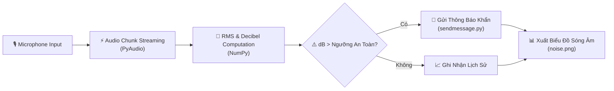

<div align="center">

# 📢 REAL-TIME NOISE DETECTOR 📢
### 🎙️ Environmental Acoustic Pollution Monitoring & Automated Alert System
*Hệ Thống Giám Sát Cường Độ Tiếng Ồn Môi Trường Thời Gian Thực & Tự Động Cảnh Báo Vượt Ngưỡng*

[](https://python.org)
[](https://people.csail.mit.edu/hubert/pyaudio/)
[](https://github.com/baolam/noise-detector)
[](https://github.com/baolam/noise-detector)

---

</div>

> [!IMPORTANT]
> **Real-Time Noise Detector** là công cụ giám sát ô nhiễm tiếng ồn tại khu dân cư, công sở hoặc trường học. Hệ thống liên tục thu nhận tín hiệu âm thanh từ microphone, tính toán mức decibel (dB) trung bình, vẽ biểu đồ biên độ và tự động kích hoạt thông báo cảnh báo khi phát hiện ô nhiễm tiếng ồn kéo dài.

---

## 📑 Mục Lục (Table of Contents)
- [✨ Tính Năng Nổi Bật](#-tính-năng-nổi-bật)
- [🏗️ Luồng Giám Sát](#️-luồng-giám-sát)
- [📂 Cấu Trúc Dự Án](#-cấu-trúc-dự-án)
- [⚙️ Công Nghệ Sử Dụng](#️-công-nghệ-sử-dụng)
- [🚀 Hướng Dẫn Cài Đặt & Sử Dụng](#-hướng-dẫn-cài-đặt--sử-dụng)
- [📜 Giấy Phép (License)](#-giấy-phép-license)

---

## ✨ Tính Năng Nổi Bật

| Biểu Tượng | Tính Năng | Mô Tả Chi Tiết |
| :---: | :--- | :--- |
| 🎙️ | **Thu Âm Thanh Độ Nhạy Cao** | Ghi nhận liên tục luồng sóng âm thanh thông qua micro với tần số lấy mẫu tiêu chuẩn (44.1kHz). |
| 📊 | **Tính Toán Biên Độ & Xuất Biểu Đồ** | Tự động chuyển đổi tín hiệu dạng sóng thành giá trị decibel (dB) và vẽ đồ thị biến thiên (`noise.png`, `example.png`). |
| 🚨 | **Kích Hoạt Tin Nhắn Cảnh Báo** | Tích hợp module `sendmessage.py` gửi cảnh báo khẩn cấp tới quản trị viên khi tiếng ồn vượt quá ngưỡng quy chuẩn. |
| ⏱️ | **Bộ Đếm Thời Gian Chu Kỳ** | Quản lý khoảng thời gian ghi âm và chu kỳ nghỉ (`time.py`) để tránh chiếm dụng tài nguyên hệ thống. |

---

## 🏗️ Luồng Giám Sát



---

## 📂 Cấu Trúc Dự Án

```bash
noise-detector/
├── 📄 index.py            # Điểm bắt đầu thu âm và tính toán biên độ tiếng ồn
├── 📄 sendmessage.py      # Module gửi tin nhắn cảnh báo khi vi phạm ngưỡng tiếng ồn
├── 📄 time.py             # Cấu hình bộ định thời và chu kỳ ghi nhận
├── 🖼️ noise.png           # Biểu đồ phân tích tiếng ồn mẫu sinh ra từ hệ thống
├── 🖼️ example.png         # Hình ảnh minh hoạ kết quả giám sát
└── 📄 README.md           # Hướng dẫn chi tiết dự án
```

---

## ⚙️ Công Nghệ Sử Dụng

- **Audio Processing**: Python, PyAudio, Wave
- **Signal Analysis & Math**: NumPy, Matplotlib
- **Notification Client**: Requests, Webhook API

---

## 🚀 Hướng Dẫn Cài Đặt & Sử Dụng

```bash
# 1. Clone repository
git clone https://github.com/baolam/noise-detector.git
cd noise-detector

# 2. Cài đặt các gói phụ thuộc
pip install pyaudio numpy matplotlib requests

# 3. Khởi chạy hệ thống giám sát
python index.py
```

---

<div align="center">

## 📜 Giấy Phép (License)

Dự án được phân phối dưới giấy phép **MIT License**.

---
**Made with ❤️ by [Bảo Lâm](https://github.com/baolam)**

</div>
